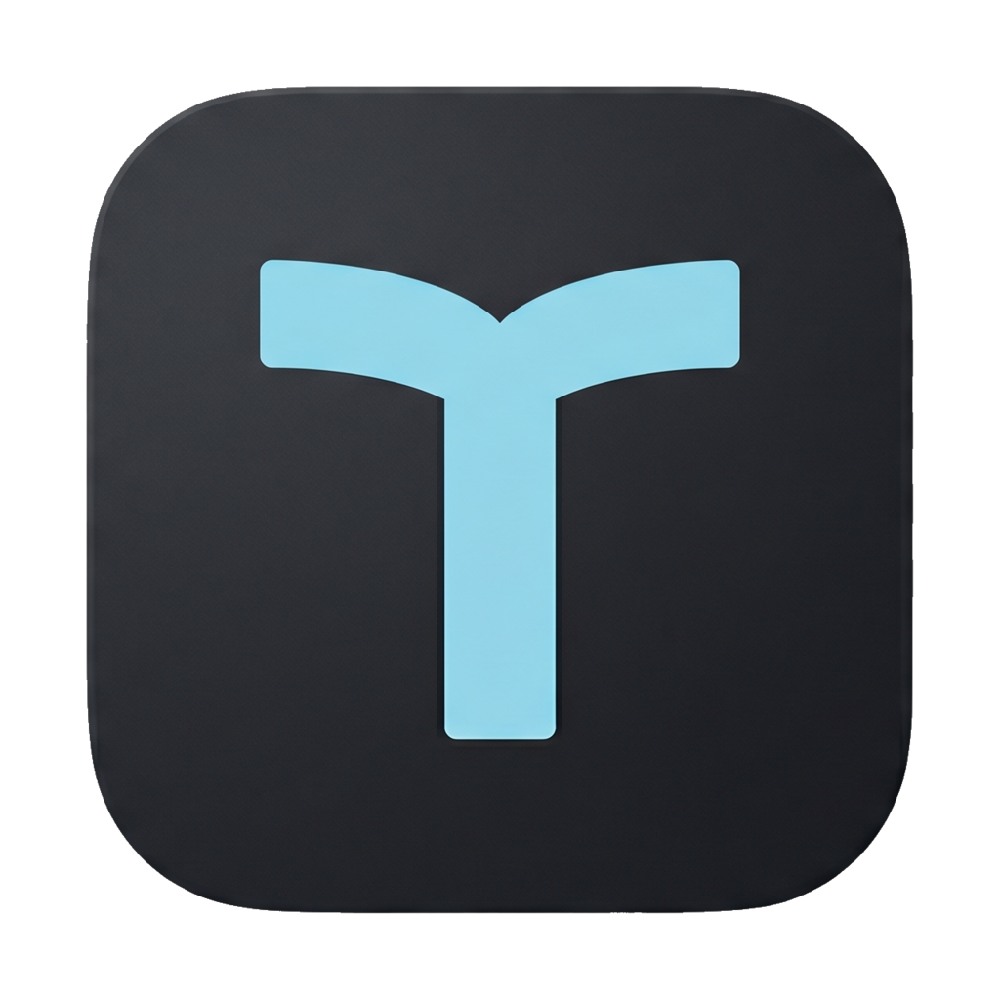
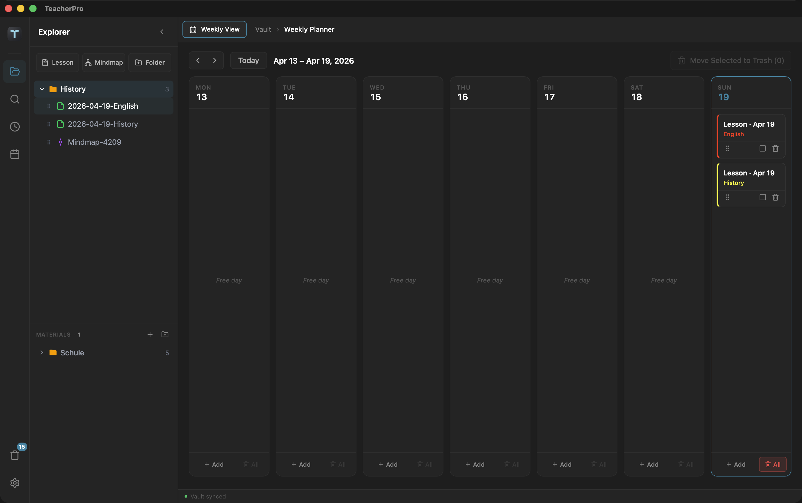
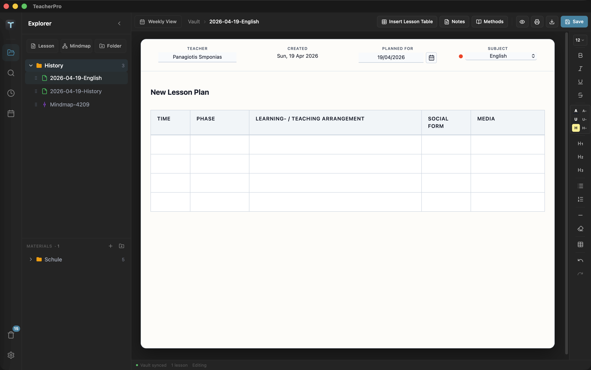
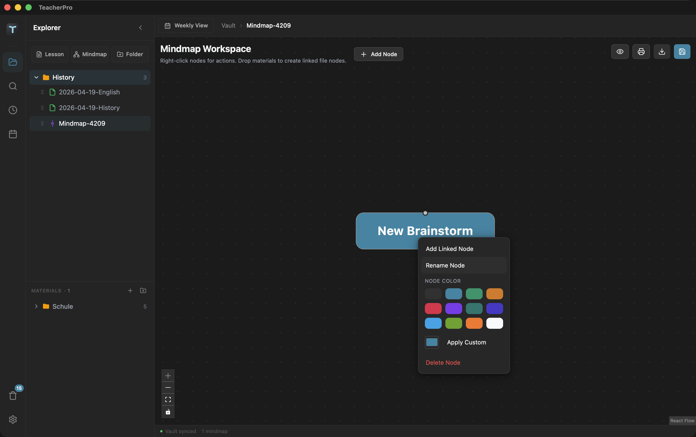
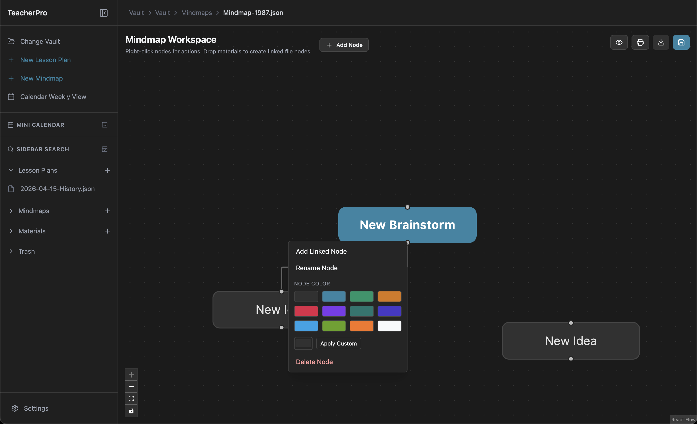

# TeacherPro

[](https://creativecommons.org/licenses/by-nc/4.0/)
[](https://github.com/Panolix/TeacherPro/actions)
[](#)

TeacherPro is a desktop app for planning lessons. It combines a lesson-plan
editor, a weekly calendar, note-taking, a method bank and mindmaps in one
window, and keeps everything in a folder you choose on your own disk — no
account, no cloud, no subscription.

It's built with Tauri (Rust) and React. I made it for my own teaching work and
use it daily; it's shared here in case it's useful to someone else.

<p align="center">
  
</p>

## Screenshots

<table align="center">
  <tr>
    <td align="center" width="50%">
      <br>
      <b>Weekly planner</b><br>
      <sub>Lessons grouped by day, colour-coded by subject. Drag to reschedule, or select several and move them to the trash.</sub>
    </td>
    <td align="center" width="50%">
      <br>
      <b>Lesson plan editor</b><br>
      <sub>Rich-text editing with a lesson metadata row and the usual pedagogy table: time, phase, activity, social form, media.</sub>
    </td>
  </tr>
  <tr>
    <td align="center" width="50%">
      <br>
      <b>Mindmaps</b><br>
      <sub>Infinite canvas for curriculum maps. Nodes can be renamed, coloured and linked; files can be dropped onto the canvas.</sub>
    </td>
    <td align="center" width="50%">
      <br>
      <b>Method bank</b><br>
      <sub>A searchable list of teaching phases, social forms and methods. Double-click an entry to drop it into the current lesson row.</sub>
    </td>
  </tr>
</table>

## How it works

Everything lives in a **vault** — a normal folder you pick on first launch.
Lessons and mindmaps are JSON files, materials stay where you put them, and the
trash is just a `Trash` folder inside the vault. Because it's all plain files,
you can back the vault up, sync it with Dropbox or put it on a USB stick
without the app caring.

If you want to know what the vault looks like before committing to it, create
an empty folder and poke around after a few minutes of use.

## What's included

**Lessons.** A rich-text editor with headings, lists, checklists, quotes,
links, tables, colours and highlights. There are a dozen bundled fonts so
documents look the same on every machine. Lesson tables are set up for the
typical pedagogy columns (time, phase, activity, social form, media) and can
grow rows or columns as needed. Lessons autosave; `Ctrl/Cmd+S` saves on demand.

**Notes.** Every lesson has a notes drawer that saves with it. Notes stay out
of PDF export unless you add them to the lesson itself.

**Method bank.** Comes with a built-in set of phases, social forms and
methods, searchable and insertable into lesson tables from a side panel or via
`/` inside a table cell.

**Mindmaps.** A node-based canvas for mapping out a unit or a topic. Nodes can
be colour-coded, renamed, connected, and external files dragged in.

**Calendar.** A week view of all planned lessons. Click a card to open the
lesson, drag it to another day to reschedule it.

**Search and trash.** One search field filters lessons, mindmaps, materials
and trash, including the text inside documents. Deleted items go to the vault's
trash where they can be restored or deleted permanently; rendered previews are
available before restoring.

**Printing and PDF.** Lessons and mindmaps print through the native print
dialog and export as PDF into an `Exports` folder. The exported page matches
what's on screen, including table borders and colours.

**Shortcuts.** `Ctrl/Cmd+S` save, `Esc` close panels, `Ctrl/Cmd+B/I/U` basic
formatting, `Ctrl/Cmd+E/L/R/J` alignment, `Ctrl/Cmd+K` link, `Ctrl/Cmd+P`
print, `Ctrl/Cmd+Shift+V` paste as plain text.

## Local AI

AI is optional and runs entirely on your machine. TeacherPro starts its own
`llama-server` process when needed and shuts it down with the app — there is no
Ollama install, no runtime to set up and nothing sent to the internet.

- **Models** are downloaded in Settings → KI-Funktionen as GGUF files from
  Hugging Face and verified with SHA-256. Sizes range from small models for
  older laptops to 27B models for machines with a big GPU.
- **Chat** streams token by token, supports thinking models, and can be stopped
  mid-answer. The rewrite/translate actions in the editor use the same engine.
- **Knowledge bases.** You can import PDFs into subject databases. They're
  chunked and embedded locally (IBM Granite Embedding 311M Multilingual R2, CPU
  only) and stored in a single SQLite index per vault. Search combines vector
  similarity with keyword search, and answers cite the source file and page
  number; you can scope the search to a subject, class, topic or a single PDF.
- **Lesson drafts.** The sparkle button in the chat panel can generate a full
  lesson table from a topic, duration and the selected knowledge-base content.
- **CUDA (optional).** On NVIDIA machines a separate acceleration pack can be
  installed from Settings to run the chat model on the GPU. Without it the app
  uses the bundled Vulkan build; either way it falls back cleanly if something
  fails.

AI settings live in Settings → KI-Funktionen. Nothing AI-related is enabled by
default, and disabling it leaves the rest of the app untouched.

## Installation

Ready-to-run installers for Windows, macOS and Linux are on the
[Releases](https://github.com/Panolix/TeacherPro/releases) page. On Linux both
`.deb` and `.rpm` packages plus an AppImage are provided.

### macOS: "App is damaged"

The macOS build is not signed with a paid Apple Developer certificate, so
Gatekeeper sometimes refuses to open it. If that happens:

1. Move `TeacherPro.app` from the `.dmg` into `/Applications`.
2. Open Terminal and run:

   ```bash
   xattr -cr /Applications/TeacherPro.app
   ```

3. Open the app normally.

Without signing there isn't a nicer workaround; the command only removes the
"downloaded from the internet" flag.

## Building from source

You need Node.js 20+ and a recent stable Rust toolchain. On Linux you also need
the usual Tauri system packages (webkit2gtk, gtk3, etc.) — see the
[Tauri prerequisites](https://v2.tauri.app/start/prerequisites/).

```bash
git clone https://github.com/Panolix/TeacherPro.git
cd TeacherPro
npm install

# Fetches the pinned llama-server build for your platform into
# src-tauri/resources/engines/ (required before building; not committed)
npm run fetch:engines

npm run tauri dev     # development with hot reload
npm run tauri build   # installer in src-tauri/target/release/bundle/
```

The engine pin lives in `scripts/engine-config.json`. To bump it, change the
pin there and regenerate the checksum with
`node scripts/fetch-engines.mjs --print-hashes <asset>`.

## Releases

Releases are tag-driven. Write the notes in
`release-notes/RELEASE_NOTES_vX.Y.Z.md`, then push a matching tag:

```bash
git tag v2.8.0
git push origin v2.8.0
```

The Release workflow builds the Windows, macOS and Linux installers and
attaches them to a draft release. The "Build Installers" workflow can rebuild
an existing version from the Actions tab.

## Documentation

- [docs/FEATURE_TRACKER.md](docs/FEATURE_TRACKER.md) — feature map and recent work
- [docs/PROJECT_PLAN.md](docs/PROJECT_PLAN.md) — early architecture notes
- [docs/AI_V3_PLAN.md](docs/AI_V3_PLAN.md) — how the AI stack works
- [release-notes/](release-notes/) — notes for every release

## Third-party models

Model weights are not bundled with the app. They're downloaded at runtime from
their official Hugging Face repositories and stay under their respective
licenses.

- Chat and draft models: various GGUF builds (Qwen, Gemma, Ministral, …); each
  model's license is listed in the app's model catalog.
- Embedding: **IBM Granite Embedding 311M Multilingual R2** (Apache 2.0). Its
  tokenizer derives from the Gemma 3 tokenizer and is subject to the
  [Gemma Terms of Use](https://ai.google.dev/gemma/terms).
- Engine: [llama.cpp](https://github.com/ggml-org/llama.cpp) (MIT).

See [THIRD_PARTY_LICENSES.md](THIRD_PARTY_LICENSES.md) for the details.

## License

TeacherPro is licensed under
[CC BY-NC 4.0](https://creativecommons.org/licenses/by-nc/4.0/). You can use,
modify and share it, but not sell it or ship it as part of a commercial
product. The full text is in [LICENSE](LICENSE).
